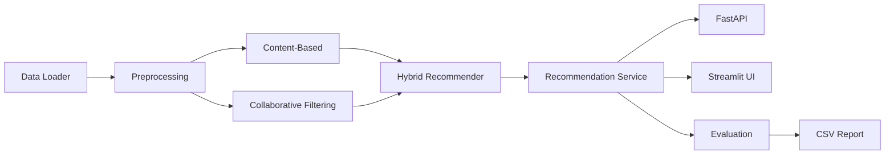
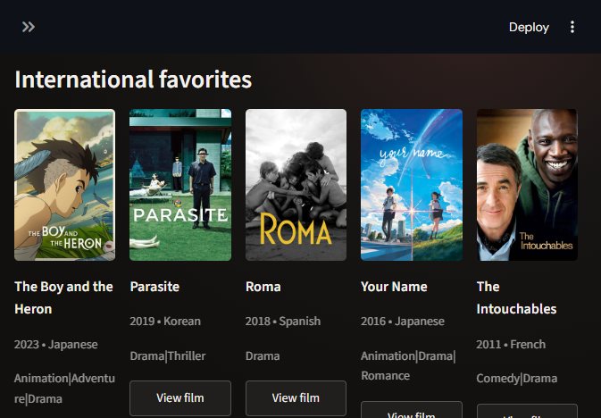
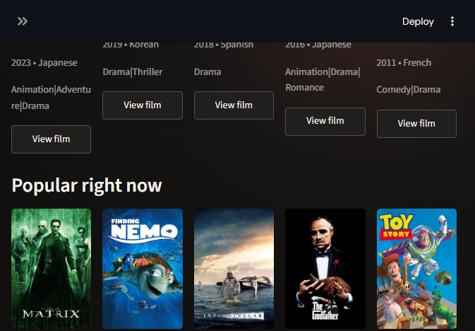
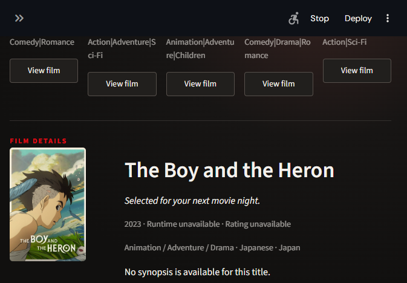

# Movie Recommendation System — AI-Powered Personalized Recommendations

This project implements a lightweight movie recommendation system in Python with a clean separation between data access, preprocessing, recommendation logic, evaluation, API, and UI. It is designed for GitHub/LinkedIn/portfolio use and is intentionally built to run locally without requiring large external downloads or hidden credentials.

## Project overview

The system supports:

- Similar movie recommendations by movie identity
- Genre-based recommendations
- User-based recommendation experiments
- Hybrid recommendations combining different signals
- Popularity baseline for comparison
- Lightweight evaluation using a holdout protocol
- API access via FastAPI
- Interactive exploration via Streamlit

## Problem statement

The objective is to provide recommendation outputs that are transparent and reproducible while respecting dataset limitations. The implementation separates recommendation logic from data loading and evaluation so that users can understand how each algorithm works rather than treating the system as a black box.

## Features

- Data loading with real MovieLens-style structure when available
- Synthetic sample fallback when internet access is unavailable
- Data validation and integrity checks
- Content-based filtering using TF-IDF on titles and genres
- Collaborative filtering using user-movie rating patterns
- Hybrid recommendation blending both sources
- Popularity baseline for comparison
- Evaluation report exported to CSV
- FastAPI endpoints for health checks and recommendations
- Streamlit UI for interactive exploration

## Dataset

The project prefers the official MovieLens small dataset from GroupLens, which normally includes files such as `movies.csv`, `ratings.csv`, and `tags.csv`. The project attempts to download the official small dataset when network access is available; otherwise it uses a small synthetic sample dataset that is clearly marked as local test data.

## Data exploration

The project stores raw and processed data under the `data/` directory and offers functions to inspect movie counts, user counts, rating distribution, missing values, duplicate rows, and invalid movie references.

## Recommendation algorithms

The implementation includes the following real algorithms:

- Popularity baseline: simple average rating by movie, useful as a reference only
- Content-based filtering: TF-IDF over movie title and genre features with cosine similarity
- Collaborative filtering: item-based rating similarity for unseen user movies
- Hybrid recommendation: weighted combination of content and collaborative scores

This project does not claim to use deep learning or LLMs.

## System architecture



## Installation

```bash
cd "E:\Amit_AI\Movie Recommendation System"
.\.venv\Scripts\python -m pip install -r requirements.txt
```

## Data download

```bash
.\.venv\Scripts\python scripts/download_data.py
```

This will attempt to fetch the official MovieLens small dataset. If it fails, the project automatically generates a synthetic sample dataset.

## Training models

```bash
.\.venv\Scripts\python scripts/prepare_data.py
.\.venv\Scripts\python scripts/train_models.py
```

## Running Streamlit

```bash
.\.venv\Scripts\streamlit run app/ui.py
```

## Running FastAPI

```bash
.\.venv\Scripts\uvicorn app.api:app --host 127.0.0.1 --port 8000
```

## API examples

```bash
curl http://127.0.0.1:8000/health
curl "http://127.0.0.1:8000/movies/search?q=Inception"
curl "http://127.0.0.1:8000/movies/1/similar?top_n=3"
curl "http://127.0.0.1:8000/recommendations/user/1?top_n=3"
```

## Evaluation methodology

The evaluation uses a simple holdout strategy: for each user, the most recent rating is reserved as the test item and the earlier ratings are used for training. This prevents test data leakage into recommendation scoring. A comparison is generated across content-based, collaborative, hybrid, and popularity methods.

## Actual results

The actual evaluation output is generated by the project script and saved under `reports/evaluation_report.csv`.

## Limitations

- The synthetic fallback dataset is intentionally small and should be replaced with official MovieLens data for large-scale evaluation.
- The collaborative recommendation logic is intentionally lightweight and suitable for local experimentation.
- Popularity is useful as a baseline but is not a substitute for personalized recommendation.

## Project structure

```text
Movie Recommendation System
├── app/
│   ├── __init__.py
│   ├── api.py
│   ├── collaborative_filtering.py
│   ├── config.py
│   ├── content_based.py
│   ├── data_loader.py
│   ├── evaluation.py
│   ├── hybrid_recommender.py
│   ├── preprocessing.py
│   ├── recommendation_service.py
│   └── ui.py
├── data/
│   ├── processed/
│   ├── raw/
│   └── sample/
├── models/
├── notebooks/
├── reports/
├── scripts/
│   ├── download_data.py
│   ├── evaluate_models.py
│   ├── prepare_data.py
│   └── train_models.py
├── tests/
├── .gitignore
├── .env.example
├── LICENSE
├── pytest.ini
├── README.md
├── requirements.txt
└── screenshots/
```

## Testing

```bash
.\.venv\Scripts\python -m pytest -q
```

## Screenshots

### Movie discovery



### Popular movies



### Film details



## Future improvements

- Add more realistic MovieLens data ingestion
- Add user- and item-normalized collaborative filtering
- Add more advanced evaluation metrics like NDCG@K and MAP@K
- Add caching and background model training jobs

## License

This project is distributed under the MIT license.
